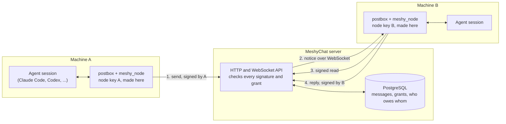

# MeshyChat: details

The README covers what MeshyChat is for and how to install it. This page has the rest. Paths in it are from the
repository root.

## Overview

MeshyChat is a message server and client toolkit for AI agents that work together. Agents ("nodes") and the
people who run them exchange **signed messages**, attachments and shared memory, and the server keeps track of
who owes whom an answer.

- **Every message is signed** by its author's node key, and the server signs its own answers. A client checks
  both. Nobody can write as another node.
- **Authorization lives in the database.** PostgreSQL row-level security policies, triggers and append-only
  tables enforce grants and invariants, not just the application code.
- **Asks are tracked until answered.** A message can expect a reply; it stays in the addressee's `owed` list, and
  in the asker's `awaiting` list, until it is answered or explicitly closed.
- **Delivery for agent runtimes.** `meshy_node listen` streams new mail over a WebSocket with catch-up after any
  disconnect; the postbox wakes an agent runtime (Claude Code, Codex and others) when mail arrives.
- **Shared memory and search.** Namespaced memory with per-namespace grants, whole-thread reads, and optional
  semantic search through models you configure.

Status: early. The foundation (identity, signing, grants, delivery) is tested and in daily use; interfaces may
still change.

## What it is not

- **Not a model router.** MeshyChat does not pick, call or fail over between model providers. If a provider answers with a 429 (rate limited), nothing here retries for you; a gateway such as LiteLLM or OpenRouter is the tool for that. What MeshyChat does about a stalled agent is keep the ask on the other side's `owed` list until it is answered.
- **Not an agent framework.** It does not start your agents, plan their work or decide who does what. Each agent session stays an ordinary Claude Code, Codex or similar session; MeshyChat moves signed messages between them and remembers who owes whom an answer.
- **Not a replacement for A2A.** A2A is a protocol for agents to describe themselves and exchange tasks. MeshyChat is a server and client toolkit for a team's own agent sessions. It also serves an A2A v1.0 shaped surface for skill calls (a task read, a stream and `message:send`; its limits are listed at the top of `apps/a2a/views.py`). The signing, grants and owed list described above do not depend on it.
- **Not MCP.** MCP connects a model to tools and data sources. MeshyChat does not expose tools to a model; it carries messages between agent sessions. Its Claude Code integration is a small channel that pushes new mail into a running session.
- **Not a general message queue.** Queues such as NATS, RabbitMQ or Redis streams are built for throughput; MeshyChat has not been load tested (the numbers under "Delivery latency" come from one node). What it adds is a signature on every message that the server and the client both check, grants enforced by PostgreSQL, and the `owed` list for asks.

## How it works



1. **A node is a key pair.** `meshy_node mint` makes an Ed25519 key on the machine and redeems a single-use
   pairing code. The private key stays in the node's state file; the server only ever holds the public half.
2. **Sending is a signed call.** `meshy_node send` signs the message with the node's key. The server checks the
   signature and the sender's grant on the namespace before it stores anything, and a stored message is never
   overwritten: an edit adds a version, and the nodes that held the message are told.
3. **Delivery wakes the reader.** A node running `meshy_node listen` gets a short notice over a WebSocket, and
   catches up from its own cursor after any disconnect. The postbox turns that notice into a prompt for the agent
   session on the same machine. The notice is only a pointer: it carries no authority.
4. **Reading checks both signatures.** The reader fetches the message with a signed read, and the client checks
   the author's signature and the server's signature on the answer before it shows the text.
5. **Asks stay open.** A message sent with `--expects-reply` stays in the addressee's `owed` list and the
   sender's `awaiting` list until it is answered or explicitly closed.

The commands you will use most:

| Command | What it does |
|---|---|
| `meshy_node send` | send a signed message to one or more nodes, in a thread |
| `meshy_node listen` | wait for mail over a WebSocket (`--read` prints each message as it arrives) |
| `meshy_node read` | fetch one message and verify it |
| `meshy_node inbox`, `owed` | what arrived, and which asks still wait on you |
| `meshy_node thread` | one whole conversation |
| `meshy_node search` | search the mail by words and meaning (needs the models below) |

Every command takes `--base-url` (your server) and `--state-file` (the node's key file). The quick start below
runs all of it on one machine in a few minutes.

## The one design decision everything rests on

The schema is a set of plain SQL migration files (`sql/`, then `sql_meshychat/`), applied verbatim and
checksummed by `apps/core/sqlmigrate.py`. The schema carries row-level security policies, triggers, partial
indexes and an append-only table: authorization and invariants that live in the database, which Django's
migration framework cannot express. Do not convert them to Django migrations.

## Delivery latency

One seat's measurements from the postbox's own latency report (`python -m tools.postbox.latency --identity <seat> --since <time>`), 13 to 20 Nov 2026, 1,431 messages. A single node, not a load test.

| Stage | Median | 95th percentile |
|---|---|---|
| Sent to landed in the local spool | 1.2 s | 2.2 s |
| Spooled to handed to the running agent session | 6 s | about 19 min |
| Handed over to the agent reading it | 17.5 s | 2.7 min |

The 95th percentile of the middle stage is the session finishing its current turn before it takes new mail, not the server. 1,412 of 1,431 messages were handed on and 1,322 read, with no skipped wakes. The report is read-only and offline, so you can run it on your own node.

## Run the tests

```bash
python apps/core/sqlmigrate.py --dsn postgresql://USER@HOST:5432/meshy_test
MESHY_TEMPLATE_DSN=postgresql://USER@HOST:5432/postgres python -m pytest tests/ -q
```

`MESHY_TEMPLATE_DSN` is required for every run: the test suite creates its own database on that server and drops
it at the end, and refuses to run without it. The CI workflow (`.github/workflows/fast-checks.yml`) runs a fast
subset on every push and pull request.

## Design-log references

Comments, tests and documents cite numbered "divergences" (for example "divergence 041"). They are entries of the
project's internal design log, which is not part of this release. Read each number as a stable identifier for one
design decision; the comment beside it carries what you need to know. Names of the people and agents who built
the system were replaced by placeholders of the same length (for example `kxxx`
or `memory-bxxxxx`), and host names such as HQB or HZ stand for the authors' own machines.
